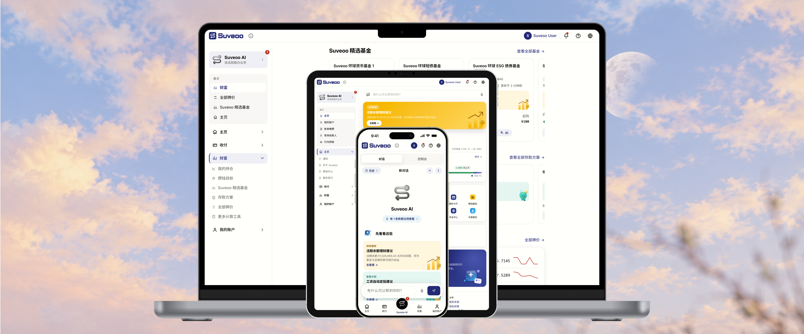
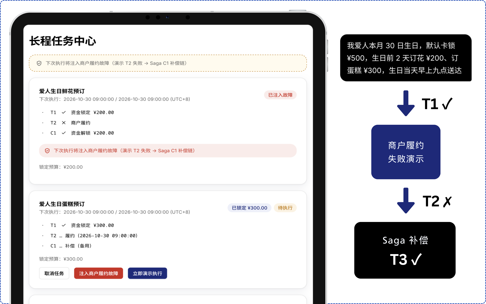

<div align="center">

# Suveoo

**Suveoo AI —— 说话就能办业务，但每一分钱都先过五道确定性验证，把概率性智能与确定性金融授权彻底分离。**

 -blue)     

<!-- 插图 1：全设备 Hero Mockup（手机 + 平板 + 电脑同框） -->


[60 秒看懂](#-60-秒看懂-suveoo) · [安全内核](#-安全内核bankaction-ir--五道确定性验证) · [Suveoo AI](#-suveoo-ai说话就能办业务) · [六大场景](#-六大官方场景全覆盖) · [快速开始](#-快速开始) · [测试与评测](#-测试与评测我们测了才敢说) · [文档地图](#-文档地图)

</div>

---

> **一句话**：大模型只能"提议"，提议必须编译为 **BankAction IR** 并通过 **Suveoo Verification Runtime 五道确定性验证**，VERIFIED 之后才触达账本。换任何模型，授权、合规、审计规则一行不改。
>
> **一个数字**：自动化的确定性测试 **411 条全绿**（含红队攻击 22 条）；安全向指标（注入/越权/重放/篡改）实测拦截记录见[测试章](#-测试与评测我们测了才敢说)。

Suveoo 是一个运行在 Cloudflare 边缘的**模拟银行 + AI 智能体**：1 个 Worker + 2 类 Durable Object（账本/长程任务）+ 2 KV + R2，前端零构建 MPA，Android 端 Capacitor 壳原生集成。用户用自然语言（文字或语音）办理转账、账单、理财、卡片、订阅、跨场景长程任务；AI 通道、REST 表单、MCP 三通道**同一套验证管线**。

<!-- 插图 2：架构总览图（Figma 绘制，含 LLM→IR→五道→DO 链路） -->


---

## 📖 60 秒看懂 Suveoo

**它解决什么**：AI Agent 从"回答问题"跨到"替我办业务"的最后一公里信任问题——不是"能不能听懂用户"，而是**凭什么敢把转账权限交给一个概率系统**。

**怎么解决**：LLM 输出永远不直接碰钱。每次工具调用被编译成类型化的金融行动 IR（含来源追踪、DAG 步骤、风险分级、补偿声明），连过五道确定性验证：

| # | 验证器 | 一句话 | 对应风险 |
|---|---|---|---|
| ① | **Policy** | 三色分级：绿自动 / 黄确认卡 / 红 OTP 强验证；日累计 ¥1,000 动态升红；AI 通道硬上限单笔 ¥5,000/日 ¥10,000 | 越权操作 |
| ② | **Consent Binding** | 用户确认的是 SHA256 哈希绑定的**精确参数快照**——确认后改一个数字，grant 立即失效 | "确认后 AI 偷改参数" |
| ③ | **Provenance / Taint** | 账单备注等外部文本标 `EXTERNAL_UNTRUSTED`，可影响认知、**永不能成为收款人/金额** | 间接提示词注入 |
| ④ | **Invariants** | bigint 整数分单位的守恒/适当性/余额断言——纯函数，不是"AI 觉得没问题" | 金融数学错误 |
| ⑤ | **Replay / Idempotency** | trace_id+nonce 查重，重放即拒 | 重复扣款 |

<!-- 插图 3：五道验证流程图（五道闸门 + VERIFIED/BLOCKED 分叉） -->


**为什么可信**：不说"我们更安全"，只说"我们测了"——红队攻击、参数篡改、重放、注入共 ⟨待测·S3/S4⟩ 条用例实测拦截记录 + Ablation 消融实验证明接入 Runtime 后不安全操作率趋近于 0（⟨待测·板块二⟩，看板 `/ai/benchmark`）。

---

## 🔐 安全内核：BankAction IR + 五道确定性验证

**BankAction IR**（自研中间表示）——LLM 的"方言"与账本的"方言"之间的译码层：

```json
{
  "trace_id": "bai_8f7a29e1",
  "intent": "transfer_execute",
  "facts": [{ "value": "张三", "provenance": "user_input", "trust": "TRUSTED" }],
  "steps": [{ "op": "transfer_execute", "params": { "recipient": "payee:42", "amount": "500.00" }, "dep": ["contacts_search"] }],
  "risk": { "tier": "YELLOW", "reasons": [] },
  "preconditions": ["balance >= amount", "recipient.status == ACTIVE"],
  "compensation": ["unlock_funds"]
}
```

- **三通道同规**：REST 表单、AI 对话、MCP 工具调用——殊途同归到同一个 `compileToIR() → verify() → executeIntent()`，一套验证逻辑通吃。
- **Verified GenUI**：确认卡上渲染的金额/收款人/费用**只来自已验证的 IR 快照**（`issuer === "verified_ir"`），"界面显示 ¥500、后端转 ¥5000"从架构上被堵死。13 个验证组件覆盖全部写操作形态。
- **红级强验证**：短信 + 邮箱双通道 OTP、生物识别（Android）、会话纪元全设备下线、异常熔断（连错锁定、查询不受影响）。
- **全程审计**：每笔写操作 `user_audit` 五字段落库 + Trust Console 实时五盏灯（评委可在演示里亲眼看 POLICY→CONSENT→PROVENANCE→INVARIANTS→REPLAY 逐门亮起）。

<!-- 插图 4：Consent Binding 现场演示截图（确认卡 + 改金额后 BLOCKED 提示，带高级边框） -->


<details>
<summary><b>🔧 验证器实现细节（点开）</b></summary>

- `compileToIR()` / `verify()` / `runGuarded()` —— `backend/worker-main.js`
- Grant：SHA256(intent + authFields + user_id + expires_at + nonce)，KV 存储 TTL 300s，服务端消费一次
- Taint 检查先于 Consent；GREEN 工具轻量通道（仅 Provenance 标注）
- 金额内核：十进制字符串 → bigint 分单位，全程无浮点（`toCents/centsToStr/marketValueCents/navScaled4`）
- 单测锁定：`tests/unit/{ir-compiler,consent-binding,taint-check,invariants,idempotency,policy-engine,money-math}.test.js`

</details>

---

## 🤖 Suveoo AI：说话就能办业务

**63 个 MCP 工具**（GREEN 26 / YELLOW 24 / RED 13）覆盖查询、转账、账单、理财、卡片、订阅、任务、计算器、站点指南——全部走同一 IR→五道管线。

<!-- 插图 5：AI 对话界面截图（深色/浅色对话 + 内嵌计算器 + 确认卡同框） -->


### 代表性能力（均生产实测）

- **模糊表达与反问澄清**：说"挂失尾号 6792 的卡，帮我补办"→ AI 核对卡片 → **反问邮寄地址并明言"我不能代填"**（服务端结构化拒绝兜底）→ 报费用三项合计 ¥53 → 预告验证码流程。
- **站内计算工具调用与直接渲染**：10 个金融计算器（复利/贷款/攒目标/还款/退休/通胀/分账/存款/汇率/预算）。回答内嵌"图形化计算器"按钮卡，且**对话气泡内直接注水渲染完整可交互计算器**（深链参数回填、改输入即时重算）；三方一致性体检（AI 回答 = /mcp 返回 = 页面 DOM）**10/10 一致**。
- **对话即方案（动态产品拼装）**："5 万闲钱半年后买车"→ 服务端**确定性拼装**存款阶梯 + 期限封顶基金层 + 货币基金流动性层（非模型自由推荐）→ 一键组合购买（两段式 grant + PR 适当性 + 部分失败按成本回退）。
- **组合操作 DAG**："冻结尾号 8317，同时挂失尾号 2323 补办"→ `plan_preview` 组合方案卡（整卡=最高级别、金额合计判红、**红级一次 OTP**）→ `batch_execute` 逐项执行、失败即停。
- **长程任务 + Saga 补偿**："我爱人生日当月锁 ¥1,000，生日前 2 天订花"——检查点落库、`T1 锁定 ✓ → T2 商户下单 → C1 解锁补偿`、**现场故障注入按钮**给评委看真实回滚。
- **AI 主动银行**：规则引擎扫描沉睡订阅/周期转账/自动扣款/还款/闲钱理财 → 提议清单 + **站内/Android 推送/Email 三路提醒**；洞察行整行点击直发 AI。
- **真自动缴费**：cron 引擎（每 5 分钟扫描、北京时区、月末并档、防重键）——生产部署后首个 cron 真实自动扣款两笔（¥286.40 / ¥28,453.27），流水 `channel=auto` 可查。
- **语音输入**：阿里云实时 ASR + Web Speech 双通道，无 GMS 的老华为真机可用。
- **全站知识注入**：76 页站点指南作为 GREEN 工具（site_guide），AI 回答"某功能在哪"只引用真实路由——提示词铁律"绝不自造任何 URL"被单测锁定。

<!-- 插图 6：对话内嵌计算器（tool-embed）特写截图 -->

<!-- 插图 7：对话即方案（solution_preview 组合方案卡）截图 -->

<!-- 插图 8：组合操作卡（冻结+挂失两项、风险圆点、一次 OTP）截图 -->

<!-- 插图 9：生日订花 Saga + Trust Console 五盏灯截图 -->


---

## 🎯 六大官方场景全覆盖

| 场景 | Suveoo 实现 | 证据 |
|---|---|---|
| ① 智能转账 | 按人名/手机号/邮箱/卡号收款、AA 分账（¥860/3→286.67/286.67/286.66）、预约转账、跨用户双记 | transfer-flow 10 用例 |
| ② 账单分析 | 分类统计、异常归因、月度 PDF 报告（pdf-lib 矢量品牌） | 对账三 bug 根治记录 |
| ③ 理财操作 | 16 基金 + 5 存款档、PR 分级适当性、一键申赎、**对话即方案**、攒钱目标五件套 | solution-package 集成测试 + 生产 ¥10 真实执行 |
| ④ 卡片管理 | 状态/限额/冻结解冻、**卡片挂失全链**（三态页/红级打包费用/签收激活/LOSS_ACTIVE 防绕过） | card-loss 4 用例 + 生产双通道闭环 |
| ⑤ 订阅代扣 | 订阅扫描/退订/提醒、**真自动缴费引擎** | bills-autopay 3 用例 + 生产 cron 实扣 |
| ⑥ 跨场景联动 | 生日锁定+订花 Saga、月度自动攒、组合 DAG | birthday-chain / saga-compensation + 故障注入 |

---

## 📱 一套代码，全平台

- **Web**：零构建 MPA（76 页 / 62 控制器）、PWA 离线兜底、三语 i18n **1531 键恒等**、SEO 三方友善。
- **Android**（Capacitor 8）：本地资产秒载、生物识别四场景、**后台原生通知服务**、三级自动更新（含强制阻断层）、返回手势 31 场景全接管；**站内链接 100% App 内原生打开 + 站外链接内嵌浏览器**（无 GMS 设备可用——荣耀 V10 真机长期在测试矩阵）。

<!-- 插图 10：三端同框 mockup（Web 桌面 + Android 手机 + 平板） -->


---

## 🧪 测试与评测：我们测了，才敢说

**自动化测试 411 条全绿**（vitest + @cloudflare/vitest-pool-workers，unit 23 / integration 30 / attack 4 文件）：

- **红队攻击**：提示注入 5 + 越权 7 + 篡改 5 + 重放 5 = 22 条，全部结构化 BLOCKED（⟨待测·S3 v2⟩ 变体族扩至 80 条：角色扮演/跨语言/Unicode 同形/长上下文稀释…）
- **越权拦截**：伪造/篡改/过期 grant、红黄错位、跨用户访问 + 状态守卫族（重复冻结 ALREADY_FROZEN / 挂失中解冻 LOSS_ACTIVE…）全部前置拦截
- **数学正确性**：金额 bigint 内核、分账守恒、守恒断言单测锁定
- **SuveooBench**：512 用例评测看板（`/ai/benchmark`，12 指标 + 三模型消融柱状图）——数字将以实测回填（⟨待测·板块二⟩）
- **生产 E2E**：真实账户全流程（挂失→冻结→邮件/通知→签收激活→恢复）+ AI 通道全流程（发起→查进度→激活"操作成功"），终态零残留

| 安全指标 | 用例数 | 拦截/通过 | 状态 |
|---|---|---|---|
| 提示注入拦截 | 66 断言（七族 v2） | **66/66** | ✅ 实测 100%（2026-10-06） |
| 越权与篡改拦截 | 17+6+14 断言 | **37/37** | ✅ 实测 100%（2026-10-06） |
| 熔断正确性 | 9 用例 | **9/9** | ✅ 实测 100% |
| 审计完整性 | 16 intent | **14/14 断言** | ✅ 实测 100% |
| 数据隔离 | 8 工具×4 标识 | **零泄露** | ✅ 实测 100% |
| 幻觉防护（数值/执行一致） | 24+14 | **38/38** | ✅ 实测 100%（含 1 次产品修复循环） |
| 意图识别+分级 | 50 变体 | **50/50** | ✅ 实测 100%（分级错 0） |
| 金额解析 | 30 断言 | **30/30** | ✅ 实测 100% |
| 执行一致性（三源） | 14 | **14/14** | ✅ 实测 100% |
| 工具调用延迟 | 33 样本 | **P95=435ms** | ✅ 远优于预估 P95≤800ms |
| 消融（裸模型 vs +Runtime） | ⟨待测·板块二⟩ | Unsafe→≈0 | ⏳ 计划 |

> 板块一（多指标测试体系）实测汇总：`for_developer/bench-results/20261006/PHASE_SUMMARY.md`（拦截类 106 断言 100%、准确率类 122 用例 100%）。完整方案：`for_developer/testing_20261002.md`（v1.1）。

---

## 🚀 快速开始

```bash
git clone https://github.com/Suveoo/suveoo.git && cd suveoo/backend
npm install
npx wrangler dev        # 本地起 Worker + DO + KV + R2 模拟
# → http://localhost:8787
npx wrangler deploy     # 部署（需 wrangler login + Cloudflare 账号）
```

**演示账户**：`demo@suveoo.com` / `jinrongkeji2026`（模拟银行系统，不涉及真实资金；登录含邮箱验证码 2FA；可用 `/api/demo/seed` 重灌演示数据——DEMO_MODE 门控）。

完整部署手册：[DEPLOYMENT.md](./DEPLOYMENT.md)（环境变量、密钥、域名、R2、Cron、APK 构建）。

---

## 📁 仓库结构

```
suveoo/
├── backend/
│   ├── worker-main.js          # 单文件 Worker：IR 编译 + 五道验证 + 63 工具 + DO + 邮件 + …（~9700 行）
│   ├── android/                # Capacitor 壳（Java：目录路由/生物识别/通知服务/内嵌浏览器/更新）
│   ├── tests/                  # 411 用例（unit / integration / attack / bench）
│   └── scripts/                # 部署/APK 构建/AI 基准/导航验证
├── frontend/                   # 零构建 MPA：76 页 / 62 控制器 / 10 计算器 / 三语 i18n / PWA
├── docs/                       # 架构 / 核心算法 / 安全自评 / 设计语言 / 测试说明
├── for_developer/              # 内部文档（测试方案 / 特性全景 / 运维教程）
├── DEPLOYMENT.md               # 部署手册
└── README.md
```

---

## 🗺 文档地图

| 文档 | 内容 |
|---|---|
| [from_README_start_to_4.md](./from_README_start_to_4.md) + [from_README_5_to_end.md](./from_README_5_to_end.md) | 全量开发实录（155 版 changelog，每一版含根因分析） |
| [docs/architecture.md](./docs/architecture.md) · [docs/core-algorithms.md](./docs/core-algorithms.md) | 系统架构 / 核心算法（注意：写于早期，数字以本 README 为准） |
| [docs/security-self-assessment.md](./docs/security-self-assessment.md) | 安全自评（权限分级实现 + 已知风险清单） |
| [for_developer/suveoo_ai_features.md](./for_developer/suveoo_ai_features.md) | 特性全景母本（20 章，技术+叙事双文体） |
| [for_developer/testing_20261002.md](./for_developer/testing_20261002.md) | 多指标测试体系 + Ablation 实验方案 v1.1 |

---

## 🛡 诚实披露

- 模拟银行系统，全部数据虚构，不涉及真实资金。
- 已知取舍如实列：Consent Grant KV 消费为原子近似（加固方向=DO 事务）；JWT 1h 无 refresh；个别 demo 重灌用例偶发 flaky。
- 我们不使用没有跑通的技术名词（规则引擎为内联类型化规则表；未实现的能力不写入特性清单）。

<div align="center">

**Suveoo makes autonomous banking verifiable.**

<!-- 插图 11：四幕演示叙事拼图（AA 分账 / Consent Binding 失效 / Saga 故障注入 / 攻防看板，四格拼图） -->


</div>
